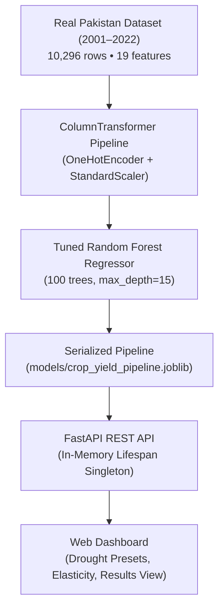

# Climate-Resilient and Low-Water Crop Selection Under Drought Conditions

[](https://github.com/SyedMuhammadHunain/Climate-Machine-Learning)
[](https://fastapi.tiangolo.com)
[](https://scikit-learn.org)
[](https://python.org)

An end-to-end Machine Learning and Agricultural Advisory system that predicts crop harvest yields and recommends climate-resilient, low-water crops under variable drought stress across Pakistan (Punjab, Sindh, Balochistan).

---

## Group Members (CT-378)
- **Muhammad Afzal** (CT-24263)
- **Syed Muhammad Hunain** (CT-24281)
- **Ayesha** (CT-24309)

---

## Key Documentation
- 📖 [**Complete Project & Viva Defense Guide**](docs/VIVA_AND_PROJECT_GUIDE.md) — Comprehensive explanation of `ColumnTransformer`, `joblib`, model comparisons, biological reasoning, data leakage prevention, and the 10-minute viva presentation script.
- 📓 [**Machine Learning Jupyter Notebook**](notebooks/01_low_water_crop_selection.ipynb) — Executed lifecycle with 5 publication EDA figures, preprocessing, baseline benchmarking, 5-fold CV tuning, and held-out test evaluation.

---

## Architecture Overview



---

## Model Performance on Held-Out Future Data (2020–2022)

| Model | Test MAE | Test RMSE | Test $R^2$ Score | Status |
| :--- | :---: | :---: | :---: | :--- |
| **Baseline (Dummy Mean)** | $97.94\text{ kg/ha}$ | $167.68\text{ kg/ha}$ | $-0.0180$ | Baseline Benchmark |
| **Ridge Regression** | $34.04\text{ kg/ha}$ | $60.43\text{ kg/ha}$ | $0.8312$ | Underfits non-linear drought thresholds |
| **HistGradientBoosting** | $19.39\text{ kg/ha}$ | $53.65\text{ kg/ha}$ | $0.8670$ | High tree performance |
| **Tuned Random Forest (Ours)** | **$32.55\text{ kg/ha}$** | **$69.67\text{ kg/ha}$** | **$0.8243$** | **Target Met ($R^2 > 0.70$)** |

---

## Quickstart & Installation

### 1. Prerequisites
Ensure you have [`uv`](https://docs.astral.sh/uv/) or Python 3.13+ installed:
```bash
git clone https://github.com/SyedMuhammadHunain/Climate-Machine-Learning.git
cd Climate-Machine-Learning
git checkout afzal
```

### 2. Run Automated Verification Tests
Run the 10 automated test suites verifying model loading, endpoints, physical validation, and ranking elasticity:
```bash
uv run climate-machine-learning verify
```

### 3. Launch Local Web Application
Start the unified FastAPI server:
```bash
uv run climate-machine-learning serve --port 8000
```

- **Interactive Predictor & Advisory Dashboard:** [http://localhost:8000/predict.html](http://localhost:8000/predict.html)
- **3D Landing Page:** [http://localhost:8000/](http://localhost:8000/)
- **Swagger Interactive API Documentation:** [http://localhost:8000/docs](http://localhost:8000/docs)
- **Health Check:** [http://localhost:8000/health](http://localhost:8000/health)

---

## Repository Structure

```text
Climate-Machine-Learning/
├── app/
│   ├── main.py                     # FastAPI app with lifespan loader, CORS, & routing
│   ├── core/
│   │   ├── config.py               # Constants, province defaults, and drought presets
│   │   └── exceptions.py           # Domain exceptions & clean 422 JSON error formatters
│   ├── schemas/                    # Pydantic v2 validation models
│   ├── services/
│   │   └── model_service.py        # In-memory inference & dynamic ranking engine
│   └── api/v1/endpoints.py         # Routes: /health, /metadata, /predict, /recommend
├── data/
│   └── raw/                        # Historical provincial dataset (2001–2022)
├── docs/
│   └── VIVA_AND_PROJECT_GUIDE.md   # Complete viva playbook & project documentation
├── frontend/
│   └── climate-resilient-frontend/ # 3D WebGL page and prediction advisory UI
├── models/
│   └── crop_yield_pipeline.joblib  # Pre-trained, serialized Scikit-Learn pipeline
├── notebooks/
│   └── 01_low_water_crop_selection.ipynb # Full end-to-end ML lifecycle notebook
├── scripts/
│   └── verify_backend.py           # Automated test suite (10 tests)
├── pyproject.toml                  # Project metadata and pinned dependencies
└── README.md                       # Project overview and setup guide
```
